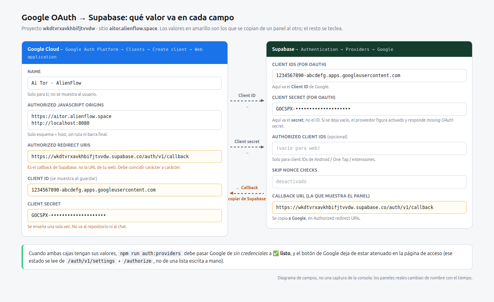

# Activar Google en Supabase, paso a paso

Proyecto `wkdtvrxavkhbifjtvvdw` · sitio `https://aitor.alienflow.space` · callback de Supabase
`https://wkdtvrxavkhbifjtvvdw.supabase.co/auth/v1/callback`

Estado de partida (medido, no supuesto): en `/auth/v1/settings` Google aparece **activado**, pero
`/auth/v1/authorize?provider=google` responde `400 Unsupported provider: missing OAuth secret`.
Es decir: el interruptor está encendido y las credenciales no existen. Eso es exactamente lo que
`npm run auth:providers` reporta como *sin credenciales* y lo que la página de acceso marca como
**sin configurar**.



> El diagrama muestra los dos paneles con los valores reales. Los recuadros amarillos son los que se
> copian de un panel al otro; el resto se teclea. No es una captura de la consola: Google renombra
> estas pantallas cada cierto tiempo, así que aquí van los nombres actuales y qué contiene cada campo.

---

## Paso 1 · Proyecto en Google Cloud

1. Entra en <https://console.cloud.google.com/> con la cuenta que vaya a ser propietaria.
2. Arriba, en el selector de proyecto, elige uno existente o **New project**.
   Nombre sugerido: `Ai Tor`. Anota el ID del proyecto: no hace falta para OAuth, pero sí para
   volver a encontrarlo.
3. No hace falta habilitar ninguna API de Google: el login con Google usa el cliente OAuth, no una
   API de producto.

## Paso 2 · Google Auth Platform (antes «OAuth consent screen»)

La configuración ya no es un formulario único, está repartida en cuatro secciones:
**Branding**, **Audience**, **Clients** y **Data Access**.

**2a. Branding** (`Google Auth Platform → Branding` → *Get started* la primera vez):

| Campo | Qué poner |
| --- | --- |
| **App name** | `Ai Tor` (es lo que el usuario ve en la pantalla de consentimiento) |
| **User support email** | un correo que leas; Google lo muestra si alguien pide ayuda |
| **App logo** | opcional, y **no** lo subas hasta publicar: un logo sin verificar retrasa la de la app |
| **Application home page** | `https://aitor.alienflow.space` |
| **Application privacy policy link** | `https://aitor.alienflow.space/privacy` — página real en [`src/pages/Privacy.tsx`](../src/pages/Privacy.tsx) |
| **Application terms of service link** | `https://aitor.alienflow.space/terms` — página real en [`src/pages/Terms.tsx`](../src/pages/Terms.tsx) |
| **Authorized domains** | `alienflow.space` — sin `https://`, sin subdominio, sin barra |
| **Developer contact information** | tu correo de trabajo |

`Authorized domains` es lo que autoriza a que las URLs legales de arriba cuelguen de ese dominio.

Las dos páginas legales se sirven como rutas de la SPA (`/privacy` y `/terms`, en
`src/App.tsx`) gracias al rewrite de `vercel.json`, y comparten maqueta en
[`src/components/legal/LegalPage.tsx`](../src/components/legal/LegalPage.tsx). Google comprueba que
cada URL responde con contenido propio y un contacto; si alguna vuelve al catch-all o queda vacía, la
verificación se queda en «revisión pendiente». Por eso `src/pages/Legal.test.tsx` exige un mínimo de
secciones, el responsable, el correo de contacto y los derechos GDPR.

**2b. Audience** (`Google Auth Platform → Audience`):

- Tipo **External**: la app la usan personas fuera de una organización de Workspace. Con **Internal**
  solo entran cuentas de tu Workspace, y el botón fallará para el resto.
- Mientras esté en **Testing**, cualquiera que no sea *test user* verá *Access blocked*; añade ahí las
  cuentas con las que vas a probar (hasta 100). Google exceptúa el login que solo pide
  `openid` + email + profile, así que con esos scopes el bloqueo por *testing* no debería aparecer.
- Cuando esté todo probado: **Publish app** → *In production*. Publicar no es verificar; para scopes
  básicos no necesitas revisión de Google.

**2c. Data Access** (`Google Auth Platform → Data Access` → *Add or remove scopes*):

| Scope | Por qué |
| --- | --- |
| `openid` | hay que añadirlo a mano |
| `.../auth/userinfo.email` | viene marcado por defecto |
| `.../auth/userinfo.profile` | viene marcado por defecto |

Son los tres que Supabase necesita. Pedir más (Drive, Calendar…) obliga a verificación y no aporta
nada al login.

## Paso 3 · Crear el cliente OAuth

`Google Auth Platform → Clients → Create client`

- **Application type**: **Web application** (no «Android», no «Desktop»).
- **Name**: `Ai Tor web`.

| Campo | Valor exacto |
| --- | --- |
| **Authorized JavaScript origins** | `https://aitor.alienflow.space` |
| | `http://localhost:8080` (solo desarrollo) |
| **Authorized redirect URIs** | `https://wkdtvrxavkhbifjtvvdw.supabase.co/auth/v1/callback` |

Dos errores de concepto que cuestan una tarde cada uno:

- **JavaScript origins** lleva **solo esquema + host**: nada de ruta, nada de barra final. Un origen
  con `/auth` o con `/` al final no coincide y Google responde `origin_mismatch`.
- **Redirect URIs** lleva **el callback de Supabase**, no la URL de esta web. Supabase termina el
  intercambio de código contra Google, así que el único destino que Google conoce es el de
  `/auth/v1/callback`. Si pones aquí `https://aitor.alienflow.space/auth`, la respuesta será
  `redirect_uri_mismatch`.

Al pulsar **Create** aparecen **Client ID** y **Client secret**. El secret se muestra una sola vez: si
se cierra el diálogo sin copiarlo, hay que crear otro cliente (o usar *Add secret* en ese cliente).

> Los cambios en orígenes y redirect URIs pueden tardar de unos minutos a unas horas en aplicarse.

## Paso 4 · Pegar las credenciales en Supabase

`Authentication → Providers → Google`

| Campo de Supabase | Qué pegar |
| --- | --- |
| **Client IDs (for OAuth)** | el **Client ID** de Google (`…apps.googleusercontent.com`) |
| **Client secret (for OAuth)** | el **Client secret** (`GOCSPX-…`), **no** el Client ID |
| **Authorized Client IDs** | vacío para web; solo si hay client IDs de Android / One Touch / extensiones (separados por comas, el web primero) |
| **Skip nonce checks** | **desactivado** (actívalo solo si sabes por qué) |

Pulsa **Save**. Ese guardado es exactamente lo que convierte `missing OAuth secret` en un flujo
funcional: el interruptor ya estaba encendido, lo que faltaba son estas dos cajas.

## Paso 5 · URLs de retorno en Supabase

`Authentication → URL Configuration`

- **Site URL**: `https://aitor.alienflow.space`
- **Redirect URLs**: añade
  - `https://aitor.alienflow.space/**`
  - `http://localhost:8080/**`

No confundir con las *Authorized redirect URIs* de Google: esas hablan del callback de Supabase. Las
**Redirect URLs** de Supabase son los destinos finales de la app después del login; si falta la tuya,
Supabase ignora el `redirectTo` y vuelve al *Site URL*.

## Paso 6 · Verificar que quedó bien

```bash
npm run auth:providers
```

Google debe pasar de `⚠️ faltan credenciales` a `✅ listo`. El script prueba
`/auth/v1/authorize` para cada proveedor, así que un ✅ significa que el flujo **puede arrancar**, no
solo que el interruptor esté encendido. El script sale con código 1 mientras quede algún proveedor
pendiente.

Sin desplegar nada, la página de acceso se corrige sola: lee `/auth/v1/settings` y luego prueba
`/auth/v1/authorize` de cada proveedor activado. El botón de Google deja de estar atenuado y pierde el
**candado ámbar** en cuanto se pulsa **revisar** junto al aviso (o al recargar la pestaña, porque el
resultado se cachea por sesión).

## «Pero si Google (y Apple) me funcionaban antes»

Funcionaban, pero no por este proyecto. Hasta el commit `Integrable Lovable OAuth`, el botón no
hablaba con Supabase: llamaba al broker de Lovable (`/~oauth/initiate` → `oauth.lovable.app`), con la
app de Google **de Lovable**. Ese broker solo acepta `aitor.lovable.app` como `redirect_uri`, así que
en `aitor.alienflow.space` ya devolvía `400 redirect_uri is not allowed` y `/~oauth/initiate` no
existe fuera del hosting de Lovable (404) — está documentado en
[lovable-supabase-migration.md](lovable-supabase-migration.md). Desde la migración el flujo va directo
contra tu proyecto (`nativeOAuth` en `src/hooks/useAuth.ts`), y ahí las credenciales de Google no
existen: el interruptor se quedó encendido, el secret no.

Para comprobarlo sin fiarse de nadie, dos comandos y una respuesta del servidor:

```bash
# ¿qué está encendido?  → google y apple salen true
curl -s -H "apikey: $VITE_SUPABASE_PUBLISHABLE_KEY" \
  https://wkdtvrxavkhbifjtvvdw.supabase.co/auth/v1/settings

# ¿puede arrancar de verdad?  → 400 missing OAuth secret
curl -s -H "apikey: $VITE_SUPABASE_PUBLISHABLE_KEY" \
  "https://wkdtvrxavkhbifjtvvdw.supabase.co/auth/v1/authorize?provider=google"
```

Ese `400` lo devuelve el servidor de Auth, no la interfaz: si el secret estuviera guardado, la
respuesta sería un `302` hacia `accounts.google.com`. Si estás seguro de haberlo pegado, revisa en este
orden: (1) que el proyecto del dashboard sea `wkdtvrxavkhbifjtvvdw` y no otro; (2) que el campo
*Client Secret (for OAuth)* tenga valor y no solo el *Client ID*; (3) que el **Save** del proveedor se
haya pulsado (el interruptor guarda solo, los campos no); (4) que el sitio use el mismo proyecto —
`grep -o 'https://[a-z0-9]*\.supabase\.co' dist/assets/index-*.js`.

Apple es el caso especial: no tiene «secret» que pegar, sino un **JWT** que caduca (máximo seis
meses). Supabase lo pide en el mismo campo; si caduca, vuelve el `missing OAuth secret`.

## Errores típicos

| Mensaje | Dónde está el problema | Arreglo |
| --- | --- | --- |
| `redirect_uri_mismatch` | Authorized redirect URIs de Google | copia el callback de Supabase carácter a carácter, mismo proyecto, sin barra final |
| `origin_mismatch` | Authorized JavaScript origins | solo `https://host`, sin ruta ni `/` final |
| `missing OAuth secret` (Supabase) | falta el **secret** en el proveedor | Paso 4, campo *Client secret* |
| `provider is not enabled` | el proveedor está apagado | activa el interruptor en `Authentication → Providers` |
| `Access blocked` / `app not verified` | Audience en *Testing* sin el usuario | añade test users o publica la app |
| El login vuelve al sitio pero sin sesión | falta la Redirect URL | Paso 5 |
| El botón sigue atenuado tras guardar | caché de la sesión del navegador | recarga la pestaña |

## Seguridad

- El **Client secret** no va al repositorio, ni a capturas, ni al chat. Vive en Supabase
  (*Authentication → Providers*) y en Google. Si se filtra: *Clients* → tu cliente → **Add secret**
  (el viejo se puede borrar) y actualiza Supabase.
- El **Client ID** es público por diseño; aparece en el flujo OAuth y no es un secreto.
- Si algún día hay más entornos (staging), el patrón es un cliente OAuth **por entorno**, cada uno con
  su callback y sus orígenes; no reutilices el cliente de producción.
- Los otros 18 métodos (Apple, Microsoft, GitHub, X, Discord, …) siguen el mismo patrón de dos cajas:
  están en la tabla de [oauth-setup.md](oauth-setup.md), con la consola de cada uno y su callback.
